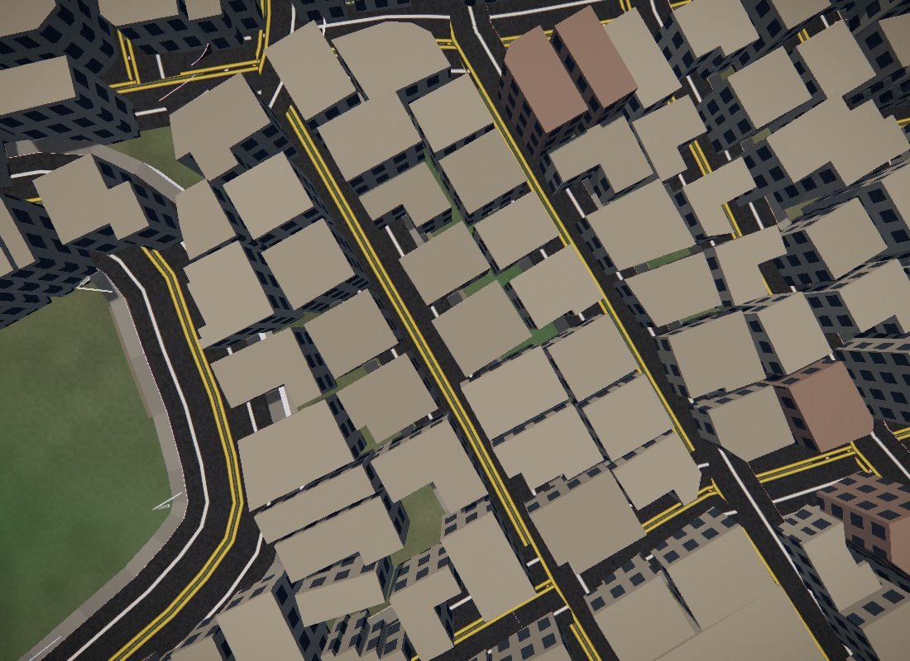
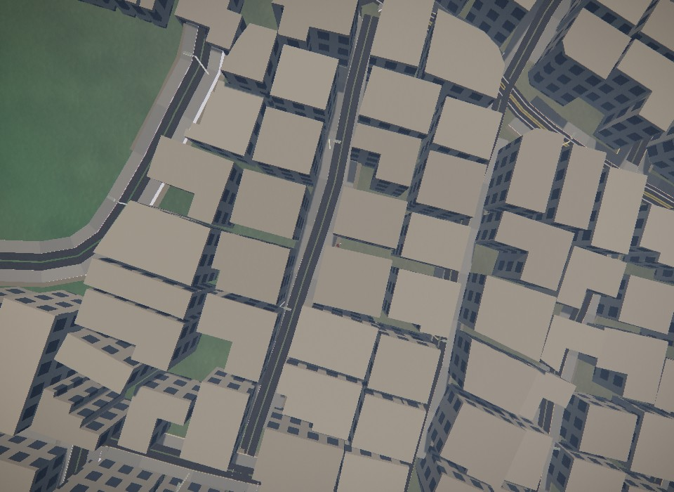
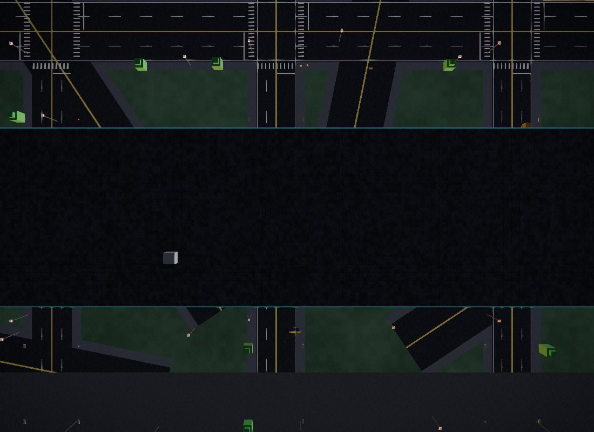
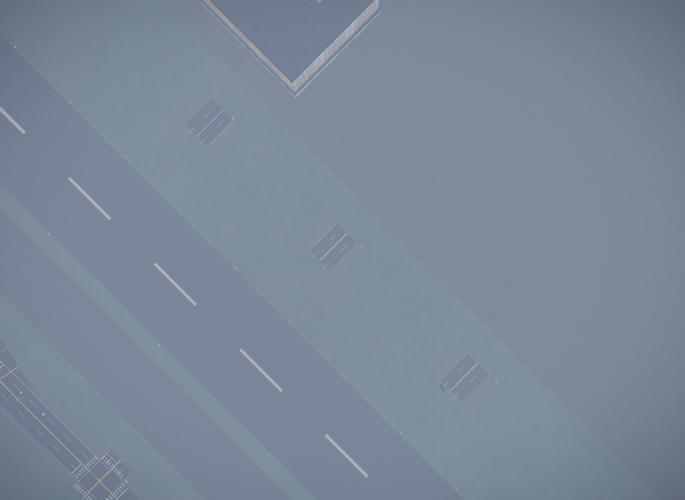

# ADR-0043 주거도로를 벽 사이 통로에 맞추기 (폭·중심선·골목)

상태: 채택 (2026-11-11, WLD-33·WLD-34, 근거 `docs/IMPROVEMENTS-2026-11-11.md` 3.5·3.6절)

## 배경
- 지도의 주거도로에는 폭 기록이 없다. 컴파일러는 양방향 주거도로를 모두 12.3 m로 그렸다. 3.75 m 차로 두 개에 고속도로 갓길 2.4 m를 더한 값이다(`roads.mjs halfOf`).
- 도로선과 건물 외곽선은 서로 다른 조사에서 왔다. 몇 m씩 어긋난다.
- 그 결과 실제 건물 129,041동이 차도 위에 섰다. 25% 넘게 덮인 건물은 46,277동이다. 차도가 벽을 덮은 주거도로는 1,535 km, 벽 사이가 3 m가 안 돼 차가 못 지나는 주거도로는 26.7 km였다.
- 공항 도시의 격자 도로는 활주로·계류장·터미널을 그대로 지났다. 블록 여백도 대로(폭 1.5배)를 반영하지 않았다.

## 결정
1. **새 굽기 단계 `build/world/fit.mjs`.** 순서는 컴파일 → grade → blocks → **fit** → grade → blocks → streets다. `build/build.mjs`가 다시 컴파일했거나 fit 규칙이 바뀌면 이 단계를 돌린다. 입력은 컴파일러 출력(`region-prefit.bin`)이다. 이미 맞춘 선을 다시 맞추지 않는다.
2. **중심선.** 주거도로 표본을 양쪽 벽 사이 가운데로 옮긴다.
   - 최대 3 m까지 옮기고, 선을 따라 ±10 m로 고른다.
   - 선의 끝, 다른 선이 만나는 표본, 다리·터널 표본은 옮기지 않는다. 이런 고정점에서 15 m 안쪽은 이동량을 줄인다. 그래서 교차점은 그대로다.
3. **폭.** 양방향은 반폭 3.25 m(3.0 m 차로 둘과 가장자리 0.25 m씩), 일방은 1.75 m를 기준으로 한다.
   - 벽이 더 가까우면 `벽까지 거리 − 0.3 m`로 줄인다.
   - 벽까지 거리는 선을 따라 잰 값의 하위 10% 값이다. 돌출 창 하나가 폭을 정하지 않게 하려는 것이다.
4. **골목(`alley`).** 반폭이 1.5 m 미만이거나, 선 어디서든 벽 사이가 3 m 미만이면 골목이다.
   - 반폭 1.25 m 포장만 그린다(차선 없는 아스팔트).
   - 길찾기(`worldnav.js`)와 차량 생성(`hwtraffic.js`)에서 뺀다. 걷기는 그대로 된다.
   - `grade.mjs`가 선을 다시 움직인 뒤(스냅·병합, 최대 6.5 m) 같은 기준으로 한 번 더 본다(`recheckPinches`).
5. **게임 쪽 폭은 한 곳에서.** `src/carriage.js`의 `carriage(r)`를 도로 그리기(`highways.js artWidth`), 경로 차로 위치(`worldnav.js`), 교통 차로(`hwtraffic.js`), 길가 지점(`game.js roadSpot`)이 함께 쓴다.
   - 맞춘 선은 자기 반폭을 쓴다. 차로 수는 차로 폭 2.75 m 아래로 내려가지 않는 만큼만 남긴다.
   - 맞추지 않은 선(간선 등)은 예전 값 그대로다.
   - `roadnet.js`가 `fit`과 `alley`를 넘긴다.
6. **공항(WLD-34, `src/citylayout.js`).**
   - 활주로, 유도로, 계류장, 터미널 구역 안의 도로 조각을 잘라낸다. 방사형 도로와 순환 도로도 자른다(Liang–Barsky).
   - 블록 여백은 선마다 실제 폭(대로는 1.5배)에 6 m를 더한다.

문서(3.5절)와 다르게 한 것과 그 이유는 다음과 같다.
- 차로 하나짜리 공유 도로(`shared`)를 따로 두지 않았다. 차로 두 개가 안 들어가는 맞춘 선은 `carriage`가 차로 하나로 그린다.
- 곡선 반경 재검사를 하지 않았다. 고정점 근처의 이동 감쇠와 3 m 상한으로 대신했다.
- 30 m 단위로 선을 더 나누지 않았다.

## 결과 (2026-11-11 굽기)
| 항목 | 전 | 후 |
|---|---|---|
| 주거도로 선 | 74,582 | 옮김 14,664, 좁힘 8,633, 골목 2,607 (370 km) |
| 차도가 벽을 덮은 주거도로 (`coveredResKm`) | 1,535 km | 87.2 km |
| 차가 못 지나는 주거도로 (골목 제외) | 26.7 km | 0 |
| 도로에 걸친 실제 건물 (`blockers capital`) | 129,041동 | 14,473동 |
| 25% 넘게 덮인 실제 건물 | 46,277동 | 1,439동 |
| 남은 절차 건물 | 218k | 247k (좁아진 도로가 자리를 남긴다) |
| 다른 도시 도로에 걸친 건물 (`blockers cities`) | 164동 (25% 넘게 4동) | 2동 (0동, 겹침 10% 미만) |

단위 테스트 `placement`가 위 기준을 지키고(`coveredResKm` 100 km 이하), `carriage`가 폭 함수와 공항 절단을 검사한다. 고치기 전 코드에서는 공항 도로 39개가 활주로나 터미널을 지나 `carriage` 테스트가 실패했다.

### 사진 (가좌동 37.5966, 126.9050, 위에서 70 m)
- 전:  12.3 m 차도가 건물 가장자리를 덮고, 노란 중앙선이 건물 밑으로 들어간다.
- 후:  차도가 건물 사이 통로 안에 들어가고, 골목은 차선 없는 포장이다.

### 사진 (인천 공항 도시)
- 전:  격자 도로가 터미널과 활주로 위로 이어진다.
- 후:  활주로·유도로 위에 도시 도로가 없다.

## 따라오는 일
- 걷기 경로망에 골목을 보행 연결로 쓰는 것은 아직 없다. 지금은 걸어서 지나갈 수 있는 포장일 뿐이다.
- 하위 10% 기준이라 벽을 덮는 차도가 87 km 남는다. 더 줄이려면 선을 30 m 단위로 나눠 구간마다 폭을 정한다.
